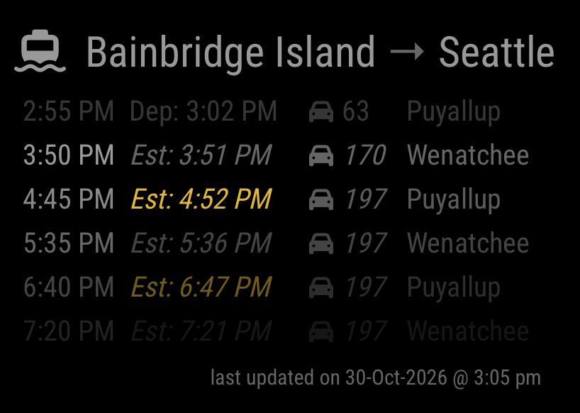

# MMM-WaStateFerry

A [MagicMirror²](https://magicmirror.builders/) module that shows the live state of one
[Washington State Ferries](https://wsdot.wa.gov/travel/washington-state-ferries) route:
upcoming and recently departed sailings, estimated departure times based on live vessel
data, drive-up vehicle space, cancellations, and the vessel on each sailing.



## Features

- Upcoming sailings with **estimated departure times** inferred from live vessel positions
  (WSF doesn't publish delays), colored by how late they're running.
- **Drive-up spaces left** on each sailing, colored as boats fill up.
- The most recent departure stays on screen with its **actual departure time** and the
  last space count seen.
- **Cancelled** sailings are shown struck through.
- Refreshes in the background without the display flickering.
- Optional: log raw WSF API data to a **MariaDB** database for your own analysis.

## Installation

```bash
cd ~/MagicMirror/modules
git clone https://github.com/zchadick/MMM-WaStateFerry.git
cd MMM-WaStateFerry
npm install   # only needed for the optional database logging
```

You need a free WSDOT Traveler Information API access code. Request one at
<https://wsdot.wa.gov/traffic/api/>.

## Update

```bash
cd ~/MagicMirror/modules/MMM-WaStateFerry
git pull
npm install
```

## Configuration

Add the module to the `modules` array in `config/config.js`:

```js
{
    module: "MMM-WaStateFerry",
    position: "bottom_right",
    config: {
        apiKey: "YOUR-WSDOT-ACCESS-CODE",
        departingTerminalID: 3, // Bainbridge Island
        arrivingTerminalID: 7   // Seattle
    }
},
```

### Options

| Option | Description | Default |
|---|---|---|
| `apiKey` | **Required.** Your WSDOT Traveler Information API access code. | `""` |
| `departingTerminalID` | Terminal the route departs from (see [Terminal IDs](#terminal-ids)). | `3` (Bainbridge Island) |
| `arrivingTerminalID` | Terminal the route arrives at. | `7` (Seattle) |
| `maxSailings` | Number of upcoming sailings to show. Recently departed sailings are shown in addition. | `5` |
| `updateInterval` | Time between data refreshes, in milliseconds. | `300000` (5 min) |
| `animationSpeed` | Fade-in speed on first load, in milliseconds. | `1000` |
| `fade` | Fade rows toward the bottom of the list. | `true` |
| `fadePoint` | Where the fade starts, as a fraction of the list (0–1). | `0.25` |
| `manualRefreshCooldown` | Minimum time between manual refreshes (reserved for upcoming hardware-button support), in milliseconds. | `30000` |
| `predictionDbUser`, `predictionDbPass`, `predictionDbHost`, `predictionDbName` | Optional MariaDB logging. See [Database logging](#optional-database-logging). | *(not set)* |
| `predictionDbPort` | MariaDB port. | `3306` |

### Terminal IDs

| ID | Terminal | ID | Terminal |
|---|---|---|---|
| 1 | Anacortes | 13 | Lopez Island |
| 3 | Bainbridge Island | 14 | Mukilteo |
| 4 | Bremerton | 15 | Orcas Island |
| 5 | Clinton | 16 | Point Defiance |
| 7 | Seattle | 17 | Port Townsend |
| 8 | Edmonds | 18 | Shaw Island |
| 9 | Fauntleroy | 19 | Sidney B.C. |
| 10 | Friday Harbor | 20 | Southworth |
| 11 | Coupeville | 21 | Tahlequah |
| 12 | Kingston | 22 | Vashon Island |

Source: the WSF `terminalbasics` API.

## Reading the display

| Column | Shows |
|---|---|
| 1 | Scheduled departure time |
| 2 | Estimated departure (*italic*), or `Dep:` and the actual departure time for a sailing that has left |
| 3 | 🚗 Drive-up spaces left (*italic* while live), or the last count seen for a departed sailing |
| 4 | Vessel |

- **Delay colors** (estimated time): 5–30 min late yellow, 31–60 red, over 60 purple.
- **Space colors**: 50% or less left yellow, 10% or less red, full purple.
- **Departed** sailings are dimmed. Every sailing that left in the last 30 minutes is shown,
  or else the single most recent one.
- **Cancelled** sailings are struck through.
- The ferry icon in the title pulses while new data is loading.

## One route per MagicMirror

This module shows a single route. You can add it to your config more than once (for
example, to show the same route in two places), but every entry must use the same
`departingTerminalID` and `arrivingTerminalID`. An entry with a different route is
ignored, and a warning is written to the MagicMirror log.

**Need a second route?** Install a renamed copy of the module. MagicMirror treats it as a
separate module with its own background process:

1. Copy the folder, e.g. `modules/MMM-WaStateFerry` → `modules/MMM-WaStateFerry2`.
2. In the copy, rename `MMM-WaStateFerry.js`, `MMM-WaStateFerry.njk`, and
   `MMM-WaStateFerry.css` to `MMM-WaStateFerry2.*`.
3. In `MMM-WaStateFerry2.js`, change `Module.register("MMM-WaStateFerry", ...)` to
   `Module.register("MMM-WaStateFerry2", ...)`, and update the file names returned by
   `getTemplate()` and `getStyles()`.
4. In the copy's `package.json`, change `"main"` to `MMM-WaStateFerry2.js`.
5. Run `npm install` in the copy if you use database logging.
6. In `config/config.js`, add an entry with `module: "MMM-WaStateFerry2"` and the second
   route's terminal IDs.

Both copies can log to the same database; rows are distinguished by their
`departing_terminal_id` / `arriving_terminal_id` columns.

## Optional: database logging

If all four of `predictionDbUser`, `predictionDbPass`, `predictionDbHost`, and
`predictionDbName` are present in the config, the module saves every raw WSF API response
to MariaDB for later analysis (for example, predicting delays or how fast sailings fill).
Leave them out and the module works without a database.

- Requires `npm install` in the module folder (installs the `mariadb` package).
- The database and an `api_snapshots` table are created automatically if they don't exist.
- Each refresh writes three rows: one per API response, with a shared UTC timestamp, the
  route, the HTTP status, and the raw JSON body.
- The module only ever **inserts** rows; it never updates or deletes data.
- If the database is unreachable, writes are queued in memory (up to about a day) and
  retried; the display is never affected.

```js
config: {
    // ...
    predictionDbUser: "ferry_logger",
    predictionDbPass: "your-password",
    predictionDbHost: "db.local",
    predictionDbName: "FERRY"
}
```

## Limitations

- WSF doesn't publish delays, so estimated times are inferred from where each vessel is
  and how late it left on its last crossing.
- A departed sailing's space count is the last one seen before its scheduled departure.
  For a late boat, more cars may have boarded after that.
- Actual departures, last space counts, and cancellations are kept in memory, so
  immediately after a MagicMirror restart, sailings that already left show estimates.
- The WSDOT APIs occasionally return errors; the module keeps showing the last good data
  where it can.

## Security notes

MagicMirror sends each module's config to the browser, so your WSDOT access code and any
database password are visible to anyone who can open your mirror's web page (for example
in the browser's developer tools). That's normal for MagicMirror modules and fine on a
home network, but don't expose your mirror's port to the internet.

## Development

Tests use Node's built-in test runner:

```bash
cd ~/MagicMirror/modules/MMM-WaStateFerry
node --test
```

The database test is skipped unless the database options are set in `config/config.js`.

## Disclaimer

Not affiliated with or endorsed by the Washington State Department of Transportation or
Washington State Ferries. Data comes from the public WSDOT Traveler Information API.

## License

[MIT](LICENSE.md)
