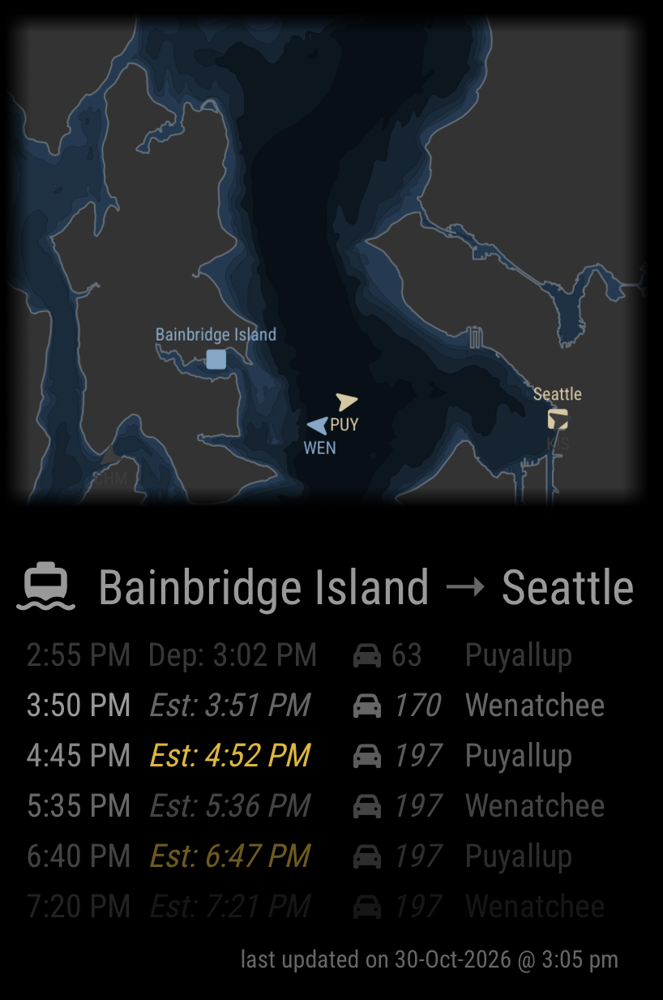

# MMM-WaStateFerry

A [MagicMirror²](https://magicmirror.builders/) module that shows the live state of one
[Washington State Ferries](https://wsdot.wa.gov/travel/washington-state-ferries) route:
upcoming and recently departed sailings, estimated departure times based on live vessel
data, drive-up vehicle space, cancellations, and the vessel on each sailing.



## Features

- Upcoming sailings with **estimated departure times** inferred from live vessel positions
  (WSF doesn't publish delays), colored by how late they're running.
- **Drive-up spaces left** on each sailing, colored as boats fill up.
- The most recent departure stays on screen with its **actual departure time** and the
  last space count seen.
- **Cancelled** sailings are shown struck through, including sailings WSF quietly removes from
  the day's schedule (the usual way WSF cancels a sailing), found by comparing against the
  season's published timetable.
- Refreshes in the background without the display flickering, plus extra refreshes one minute
  before each departure (scheduled and estimated) to catch the latest status and space count.
- All times are shown in Seattle (Pacific) time, whatever the mirror's own time zone.
- Optional **map view** of Puget Sound (land, water, and depth bands from NOAA charts).
- Optional: log raw WSF API data to a **MariaDB** database for your own analysis.

## Installation

```bash
cd ~/MagicMirror/modules
git clone https://github.com/zchadick/MMM-WaStateFerry.git
cd MMM-WaStateFerry
npm install   # needed for the map view and the optional database logging
```

You need a free WSDOT Traveler Information API access code. Request one at
<https://wsdot.wa.gov/traffic/api/>.

## Update

```bash
cd ~/MagicMirror/modules/MMM-WaStateFerry
git pull
npm install
```

## Configuration

Add the module to the `modules` array in `config/config.js`:

```js
{
    module: "MMM-WaStateFerry",
    position: "bottom_right",
    config: {
        apiKey: "YOUR-WSDOT-ACCESS-CODE",
        departingTerminalID: 3, // Bainbridge Island
        arrivingTerminalID: 7   // Seattle
    }
},
```

### Options

| Option | Description | Default |
|---|---|---|
| `apiKey` | **Required.** Your WSDOT Traveler Information API access code. | `""` |
| `departingTerminalID` | Terminal the route departs from (see [Terminal IDs](#terminal-ids)). | `3` (Bainbridge Island) |
| `arrivingTerminalID` | Terminal the route arrives at. | `7` (Seattle) |
| `maxSailings` | Number of upcoming sailings to show. Recently departed sailings are shown in addition. | `5` |
| `updateInterval` | Time between data refreshes, in milliseconds. | `300000` (5 min) |
| `animationSpeed` | Fade-in speed on first load, in milliseconds. | `1000` |
| `fade` | Fade rows toward the bottom of the list. | `true` |
| `fadePoint` | Where the fade starts, as a fraction of the list (0–1). | `0.25` |
| `manualRefreshCooldown` | Minimum time between refreshes from the [GPIO buttons](#optional-gpio-leds-and-buttons-raspberry-pi), in milliseconds. Presses sooner than this after the last button refresh are ignored. | `30000` |
| `gpioStatusLed`, `gpioRefreshLed`, `gpioButtons` | Optional LEDs and refresh buttons on a Raspberry Pi; see [GPIO](#optional-gpio-leds-and-buttons-raspberry-pi). | none (off) |
| `predictionDbUser`, `predictionDbPass`, `predictionDbHost`, `predictionDbName` | Optional MariaDB logging. See [Database logging](#optional-database-logging). | *(not set)* |
| `predictionDbPort` | MariaDB port. | `3306` |
| `type` | What this entry shows: `"sailings"` (the list) or `"map"`. See [Map view](#map-view). | `"sailings"` |

### Terminal IDs

| ID | Terminal | ID | Terminal |
|---|---|---|---|
| 1 | Anacortes | 13 | Lopez Island |
| 3 | Bainbridge Island | 14 | Mukilteo |
| 4 | Bremerton | 15 | Orcas Island |
| 5 | Clinton | 16 | Point Defiance |
| 7 | Seattle | 17 | Port Townsend |
| 8 | Edmonds | 18 | Shaw Island |
| 9 | Fauntleroy | 19 | Sidney B.C. |
| 10 | Friday Harbor | 20 | Southworth |
| 11 | Coupeville | 21 | Tahlequah |
| 12 | Kingston | 22 | Vashon Island |

Source: the WSF `terminalbasics` API.

## Reading the display

| Column | Shows |
|---|---|
| 1 | Scheduled departure time |
| 2 | Estimated departure (*italic*), or `Dep:` and the actual departure time for a sailing that has left |
| 3 | 🚗 Drive-up spaces left (*italic* while live), or the last count seen for a departed sailing |
| 4 | Vessel |

- **Delay colors** (estimated time): 5–30 min late yellow, 31–60 red, over 60 purple.
- **Space colors**: 50% or less left yellow, 10% or less red, full purple.
- **Departed** sailings are dimmed. Every sailing that left in the last 30 minutes is shown,
  or else the single most recent one.
- **Cancelled** sailings are struck through. A sailing in the season's timetable that WSF has
  removed from today's schedule counts as cancelled as soon as it disappears, and returns to
  normal if WSF puts it back. If a boat still leaves on a removed sailing, it shows as departed.
- The ferry icon in the title pulses while new data is loading, and turns **red** while the
  optional database logging is configured but not working (see [Database logging](#optional-database-logging)).
- If an update fails, the last good data stays on screen and the footer says "(latest update
  failed)".

## Map view

Add a second entry with `type: "map"` to show a map of Puget Sound, drawn from NOAA chart
data: land, water, depth bands, contour lines, and the coastline, with live ferry and terminal
markers on top. The map itself is drawn once and saved (in the module's `map_cache/` folder), so
it's quick to show on later starts and costs the mirror almost nothing to display. It is rebuilt
only when map settings change; the markers update with each data refresh.

**Markers:**
- **Ferries** (in-service only) show as an arrow pointing in the direction of travel, or an
  anchor when docked, with the vessel's abbreviation (e.g. `PUY` for Puyallup) below.
  Colors: boats on your route heading to your departing terminal, heading to your arriving
  terminal, or docked; other boats are drawn faintly.
- **Terminals** show as a square with the terminal's name above, colored as your departing
  terminal, your arriving terminal, or other.
- Labels can overlap at busy terminals.

```js
{
    module: "MMM-WaStateFerry",
    position: "top_left",
    config: {
        type: "map",
        mapUpperLeft: { lat: 47.73803, lon: -122.61430 },  // Kingston area
        mapLowerRight: { lat: 47.57325, lon: -122.29558 }, // Seattle and Lake Union
        mapWidth: 400
    }
},
```

- **The map needs a sailings entry.** Keep your regular `MMM-WaStateFerry` entry (with
  `apiKey` and the route); the map uses the same route and doesn't need them repeated. A map
  without a sailings entry still draws, but without ferry or terminal markers, and a warning
  is logged.
- You can show **several maps** at once (for example a close-up and an overview).
- Requires `npm install` in the module folder.

### Map options

| Option | Description | Default |
|---|---|---|
| `mapUpperLeft` | **Required.** Upper-left (north-west) corner, `{ lat, lon }` in decimal degrees. | *(none)* |
| `mapLowerRight` | **Required.** Lower-right (south-east) corner. | *(none)* |
| `mapWidth` | Map width in pixels (1–2000). The height follows the area's shape. | `400` |
| `mapDetail` | `"auto"`, `"low"`, `"medium"`, or `"high"`. `"auto"` picks from the map's scale. | `"auto"` |
| `mapLayers` | `{ depth, contours, coastline }`, each `true` or `false`. | all `true` |
| `mapColors` | `land`, `water`, `contour`, `coastline`, and `depth` (six colors, 30 ft to 600 ft). | dark grey land, blue water darkening with depth |
| `mapLineWidths` | `{ coastline, contour }` in pixels. | `{ coastline: 1, contour: 0.5 }` |
| `mapEdgeFade` | Share of each side that fades to black (`0` to `0.5`; `0` turns it off). | `0.04` |
| `mapMarkerSize` | Ferry and terminal icon size in pixels (4–64). Adjust to suit your screen. | `14` |
| `mapLabelSize` | Label text size in pixels (4–64). | `11` |
| `mapMarkerColors` | `otherBoat`, `dockedBoat`, `dockedBoatLabel`, `toDeparting`, `toArriving`, `departingTerminal`, `arrivingTerminal`, `otherTerminal`. A docked boat's anchor (`dockedBoat`) is black, so it marks its terminal's square as "boat docked"; its abbreviation (`dockedBoatLabel`) stays light grey. | black, muted greys, blue, and sand |
| `mapIcons` | Font Awesome icon names: `underway`, `docked`, `terminal`. | `fa-location-arrow`, `fa-anchor`, `fa-square` |

You only need to list the colors, icons, layers, or line widths you want to change; the rest
keep their defaults. Coordinates must be decimal degrees (to convert degrees-minutes-seconds:
degrees + minutes/60 + seconds/3600, negative for west longitudes and south latitudes).
`mapUpperLeft` and `mapLowerRight` have no defaults; if either is missing, or any map setting is
invalid, the problems are listed on the mirror in place of the map.

**Map shape:** the width is fixed by `mapWidth` and the height follows the area you choose.
Very wide or very tall areas are limited to between 5:1 and 1:5; the upper-left corner is kept
and the right or bottom is trimmed.

**Coverage:** the map data covers longitude −123.35 to −122.15 and latitude 47.00 to 48.80
(Olympia to the San Juan Islands, Hood Canal to Everett). Parts of the map outside that area
are shown black with cross-hatching and labelled "outside map coverage". Small inland lakes and
rivers aren't in nautical charts and appear as land.

### Map data and NOAA

The map is derived from NOAA Electronic Navigational Charts, merged and simplified for display.
**It is not an official NOAA chart and is not for navigation.** This project is not affiliated
with or endorsed by NOAA. See [`map_data/README.md`](map_data/README.md) for the source, NOAA's
terms and citation, the data's limitations, and how it was made.

## One route per MagicMirror

This module shows a single route. You can add it to your config more than once (for
example, to show the same route in two places), but every entry must use the same
`departingTerminalID` and `arrivingTerminalID`. An entry with a different route is
ignored, and a warning is written to the MagicMirror log.

**Need a second route?** Install a renamed copy of the module. MagicMirror treats it as a
separate module with its own background process:

1. Copy the folder, e.g. `modules/MMM-WaStateFerry` → `modules/MMM-WaStateFerry2`.
2. In the copy, rename `MMM-WaStateFerry.js`, `MMM-WaStateFerry.njk`, and
   `MMM-WaStateFerry.css` to `MMM-WaStateFerry2.*`.
3. In `MMM-WaStateFerry2.js`, change `Module.register("MMM-WaStateFerry", ...)` to
   `Module.register("MMM-WaStateFerry2", ...)`, and update the file names returned by
   `getTemplate()` and `getStyles()`.
4. In the copy's `package.json`, change `"main"` to `MMM-WaStateFerry2.js`.
5. Run `npm install` in the copy if you use database logging.
6. In `config/config.js`, add an entry with `module: "MMM-WaStateFerry2"` and the second
   route's terminal IDs.

Both copies can log to the same database; rows are distinguished by their
`departing_terminal_id` / `arriving_terminal_id` columns.

## Optional: database logging

If all four of `predictionDbUser`, `predictionDbPass`, `predictionDbHost`, and
`predictionDbName` are present in the config, the module saves every raw WSF API response
to MariaDB for later analysis (for example, predicting delays or how fast sailings fill).
Leave them out and the module works without a database.

- Requires `npm install` in the module folder (installs the `mariadb` package).
- The database and an `api_snapshots` table are created automatically if they don't exist.
- Each refresh writes three rows: one per API response (schedule, vessel locations, sailing
  space), with a shared UTC timestamp, the route, the HTTP status, and the raw JSON body.
- Once a day, the season's timetable for the route is saved as one more row (`sailings`).
- The module only ever **inserts** rows; it never updates or deletes data.
- If the database is unreachable, writes are queued in memory (up to about a day) and
  retried; the display is never affected.
- **Red title icon:** while logging is configured but not working (writes failing, or the
  `mariadb` package not installed), the ferry icon in the list's title turns red. It returns
  to normal once writes succeed again; details are in the MagicMirror log.

```js
config: {
    // ...
    predictionDbUser: "ferry_logger",
    predictionDbPass: "your-password",
    predictionDbHost: "db.local",
    predictionDbName: "FERRY"
}
```

## Optional: GPIO LEDs and buttons (Raspberry Pi)

Two status LEDs and any number of refresh buttons wired to the Pi's GPIO pins. Each part is
off unless its setting is present, and the module works the same without them.

```js
config: {
    // ...
    gpioStatusLed: 12,      // GPIO (BCM) numbers, not physical pin numbers
    gpioRefreshLed: 7,
    gpioButtons: [24, 23]   // every button triggers a refresh
}
```

- **STATUS LED:** off until the first update arrives. Then it fades slowly in and out (once
  every 10 seconds) while everything works, and pulses quickly (twice a second) while any
  problem is active: the latest update failed, the sailing-space feed failed, the season's
  timetable couldn't be loaded, database logging is failing, or a map couldn't be built. It
  returns to the slow pulse once the next update succeeds or the database recovers.
- **REFRESH LED:** blinks twice a second while data is being refreshed (every refresh, not
  only button presses), for at least 5 blinks.
- **Buttons:** a press refreshes right away and restarts the 5-minute countdown. Presses within
  `manualRefreshCooldown` (30 seconds) of the last button refresh are ignored.
- **Wiring:** each LED from its GPIO pin through a resistor (e.g. 330 Ω) to ground; each button
  between its GPIO pin and ground (the Pi's internal pull-up is used, so no resistor is needed).
- **Requirements:** Python 3 and gpiozero, both included with Raspberry Pi OS. If gpiozero is
  missing, the log says so; install it with `sudo apt install python3-gpiozero`.
- Both LEDs turn off when MagicMirror stops.
- Put these settings in the sailing-list entry, not a `type: "map"` entry.

How it runs: the module starts one small Python helper (`gpio/gpio_helper.py`) that drives the
pins with gpiozero. If the helper stops unexpectedly it's restarted (at most 5 times an hour),
and it's restarted if its memory grows past 60 MB. A GPIO problem never affects the display;
details are in the MagicMirror log.

## Limitations

- WSF doesn't publish delays, so estimated times are inferred from where each vessel is
  and how late it left on its last crossing. Delays start fresh each day: once the day's last
  sailing has left, and when the schedule moves to a new day.
- A departed sailing's space count is the last one seen before its scheduled departure.
  For a late boat, more cars may have boarded after that.
- Actual departures, last space counts, and cancellations are kept in memory, so
  immediately after a MagicMirror restart, sailings that already left show estimates.
- Removed sailings are detected only on simple two-terminal routes (e.g. Bainbridge Island ↔
  Seattle): WSF's timetables for multi-stop routes don't say where each departure goes. On
  those routes, and on days WSF runs a special schedule that doesn't match the timetable,
  only sailings WSF flags as cancelled are shown struck through.
- After a restart, a removed sailing whose time has already passed may show as cancelled even if
  a boat ran it late (the module didn't see it leave).
- The WSDOT APIs occasionally return errors; the module keeps showing the last good data
  where it can.

## Security notes

MagicMirror sends each module's config to the browser, so your WSDOT access code and any
database password are visible to anyone who can open your mirror's web page (for example
in the browser's developer tools). That's normal for MagicMirror modules and fine on a
home network, but don't expose your mirror's port to the internet.

## Development

Tests use Node's built-in test runner:

```bash
cd ~/MagicMirror/modules/MMM-WaStateFerry
node --test
```

The database test is skipped unless the database options are set in `config/config.js`.

## Disclaimer

Not affiliated with or endorsed by the Washington State Department of Transportation,
Washington State Ferries, or NOAA. Sailing data comes from the public WSDOT Traveler
Information API; map data is derived from NOAA Electronic Navigational Charts and is not for
navigation.

## License

[MIT](LICENSE.md)
